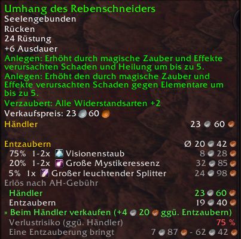
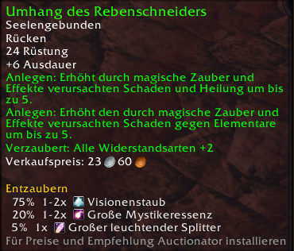
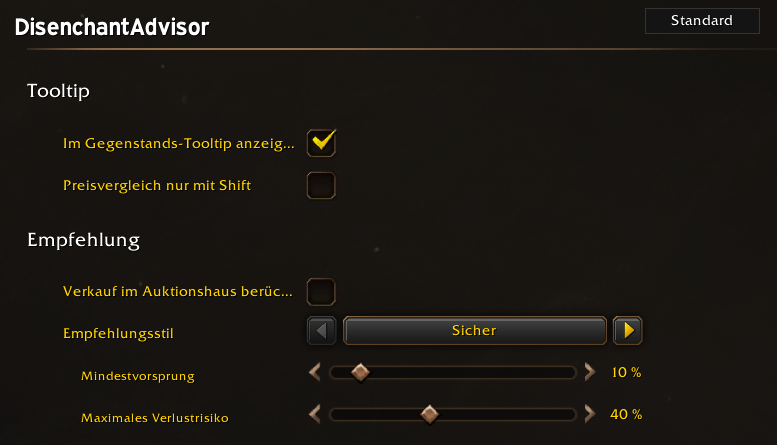

# DisenchantAdvisor

Should you disenchant this, sell it to a vendor or put it on the auction house? DisenchantAdvisor
answers that in the item tooltip, for World of Warcraft Forever (Interface 16001).

On every uncommon, rare and epic weapon and armor piece it shows:

- **what disenchanting gives**: each material with its chance, amount and auction price
- **what each option earns** after the 5 % auction house cut: vendor, auction house, disenchanting
- **a recommendation**, with the lead over the next best option
- **the loss risk**: how often a single disenchant earns less than simply selling the item, and
  the range one disenchant can give

The screenshots are from the German client; the addon is in English and German.

## Installation

1. Download `DisenchantAdvisor-<version>.zip` from the
   [latest release](https://github.com/NyoCon/DisenchantAdvisor/releases/latest).
2. Unpack it into `World of Warcraft/_forever_/Interface/AddOns/`, so that you get
   `AddOns/DisenchantAdvisor/DisenchantAdvisor.toc`.
3. `/reload` or restart the game, then hover over an item.

(*Code > Download ZIP* works too, but unpacks to `DisenchantAdvisor-main`: rename the folder to
`DisenchantAdvisor`.)

Prices come from [Auctionator](https://www.curseforge.com/wow/addons/auctionator), which is
optional but recommended. Without it the tooltip shows only the materials and their chances:

## Reading the tooltip

Taking the example above (auction house selling switched off in the settings, so only vendor and
disenchanting are compared; the *Händler* line above the block is Auctionator's own):

| Line | Meaning |
|---|---|
| *Entzaubern* (Disenchant) **Ø 20s 42c** | expected value of one disenchant, before the auction house cut |
| 75 % 1-2x Vision Dust … | the possible results: chance, amount and auction value of each material |
| *Erlös nach AH-Gebühr* (Proceeds after AH cut) | what each option earns: vendor 23s 60c, disenchanting 19s 40c after the 5 % cut. The winner is green |
| » *Beim Händler verkaufen* (Sell to a vendor) | the recommendation, here with its lead of 4s 20c over disenchanting |
| *Verlustrisiko* (Loss risk) **75 %** | in 75 % of the cases a single disenchant earns less than the vendor |
| *Eine Entzauberung bringt* (One disenchant gives) | the worst and best single disenchant: 7s 87c to 62s 42c |

Disenchanting is worth a bit less than the vendor on average here and loses in three out of four
cases, so the advice is to sell.

Notes that can show up:

- `+?` after a value: some material has no auction price, the real value is higher
- `?` as chance, `(unconfirmed)`: rare items of item level 5-15, a band that only exists in Forever;
  assumed to be like 16-20
- auction house `(bound)`: soulbound or bind on pickup, cannot be sold there
- auction house `(base item)`: Auctionator only has a price for the item without its random suffix
- auction house `(5 days old)` / `(over 3 weeks old)`: when Auctionator last saw the item
- recommendation in orange: `close call` (ahead by less than the minimum lead), `risky`
  (disenchanting recommended although its loss risk is above the maximum) or `prices missing`
  (disenchanting lost, but some material prices are missing, so it might still be better)
- loss risk colour: green up to half the maximum loss risk, orange up to it, red above. If
  disenchanting is not recommended, it tells how rarely it would still have paid off
  (100 % = never)
- `needs an enchanter`: disenchanting wins but this character cannot disenchant

## Settings

*Esc > Options > AddOns > DisenchantAdvisor*, or `/dadv`:

| Setting | Default | |
|---|---|---|
| Show in item tooltips | on | |
| Modifier key for details | None | None, Ctrl, Shift or Alt. With a key, the proceeds of each option and the range of a single disenchant are only shown while it is held; materials and recommendation stay visible |
| Consider selling at the auction house | on | off: the item is only compared with the vendor price; the materials are still valued at auction prices |
| Recommendation style | Safe | see below |
| Minimum lead | 10 % | how much more disenchanting has to earn on average than the best sale |
| Maximum loss risk | 40 % | in how many cases a single disenchant may earn less than the best sale |

Recommendation styles, for when disenchanting earns most on average:

- **Safe**: recommend disenchanting only if it leads by the minimum lead **and** its loss risk is at
  most the maximum; otherwise recommend the sale and say why, e.g.
  `Sell to a vendor (disenchanting: +48c on average, 75 % loss risk)`
- **Balanced**: disenchant if the lead **or** the loss risk is good enough
- **Average (risky)**: always the highest average; the lead and loss risk only add the
  `close call` and `risky` notes

### Chat commands

| Command | Effect |
|---|---|
| `/dadv` | opens the settings |
| `/dadv status` | settings and help (also shows the last tooltip error, if any) |
| `/dadv details none\|ctrl\|shift\|alt` | price comparison always (default) or only while that key is held |
| `/dadv on\|off` | tooltip lines on or off |
| `/dadv check <item link>` | the evaluation of a shift-clicked item in the chat |

## How it works

- **Bands**: which materials an item can give depends on class (weapon/armor), quality and item
  level. The bands are Forever's client table `ItemDisenchantLoot`. The client does not contain
  what drops in a band; chances and amounts are Classic 1.12's as reproduced by the
  [vmangos](https://github.com/vmangos/core) world database: the items of a band give its
  `disenchant_id`, whose rows in `disenchant_loot_template` are the drops. One deviation: for epics
  of level 56+ vmangos also lists a Large Brilliant Shard next to the Nexus Crystal, which
  [cmangos classic-db](https://github.com/cmangos/classic-db) and Classic 1.12 do not; it is left
  out.
- **Exceptions**: `Data/NoDisenchant.lua` (items flagged as not disenchantable) and
  `Data/OwnLoot.lua` (items with their own disenchant loot) come from the client's
  `ItemSparse`/`Item` tables.
- **Material value**: Auctionator price. Lesser and greater essences convert 3:1 into each other, so
  each is worth at least its partner's price × 3 (or ÷ 3); the higher value counts.
- **Disenchanting value**: Σ chance × average amount × material price, minus the 5 % auction house
  cut (the materials have to be sold too).
- **Auction house value**: Auctionator's price for the item link, minus the 5 % cut. The deposit and
  the risk of the item not selling are not counted.
- **Loss risk**: one disenchant gives exactly one row of the band, its amount equally likely
  anywhere from min to max (how loot works on the Classic emulators). Every outcome
  (row × amount, chance = row chance ÷ number of amounts) is valued after the cut and compared with
  the best non-disenchant option; the loss risk is the summed chance of the outcomes below it. Needs
  a price for every material, otherwise no risk is shown.
- **Decision** (`Advisor.lua`, `A.Decide`): options sorted by value; if disenchanting is first, the
  recommendation style checks the lead (`disenchant ≥ best sale × (1 + minimum lead)`) and the loss
  risk against the settings and may fall back to the best sale. Without a loss risk (missing
  material prices, nothing to sell) the highest average counts.
- **Bound items**: `C_Item.IsBound` for items in bags, bank or equipped, else the binding line of
  the tooltip; bind on pickup items are always bound. Bound items have no auction house option.
- **Tooltip hook**: `TooltipDataProcessor.AddTooltipPostCall` for item tooltips (GameTooltip and
  ItemRefTooltip); errors are caught and shown by `/dadv status`.

## Development

- `luajit dev/run.lua` loads the addon with a small mock of the WoW API and prints the tooltip
  lines of a few test items as text (`LOCALE=enUS luajit dev/run.lua` for English).
- `python3 tools/update_drops.py [mangos.sql or db zip] [build]` regenerates `Data/Drops.lua` from
  Forever's bands and the vmangos database (downloads the newest vmangos snapshot without a path).
- `python3 tools/update_data.py [build]` regenerates `Data/NoDisenchant.lua` and
  `Data/OwnLoot.lua` via [wago.tools](https://wago.tools). Rerun both after a client patch.

## License

MIT, see `LICENSE`. The drop chances in `Data/Drops.lua` are game data taken from the vmangos
world database (GPL-2.0).
